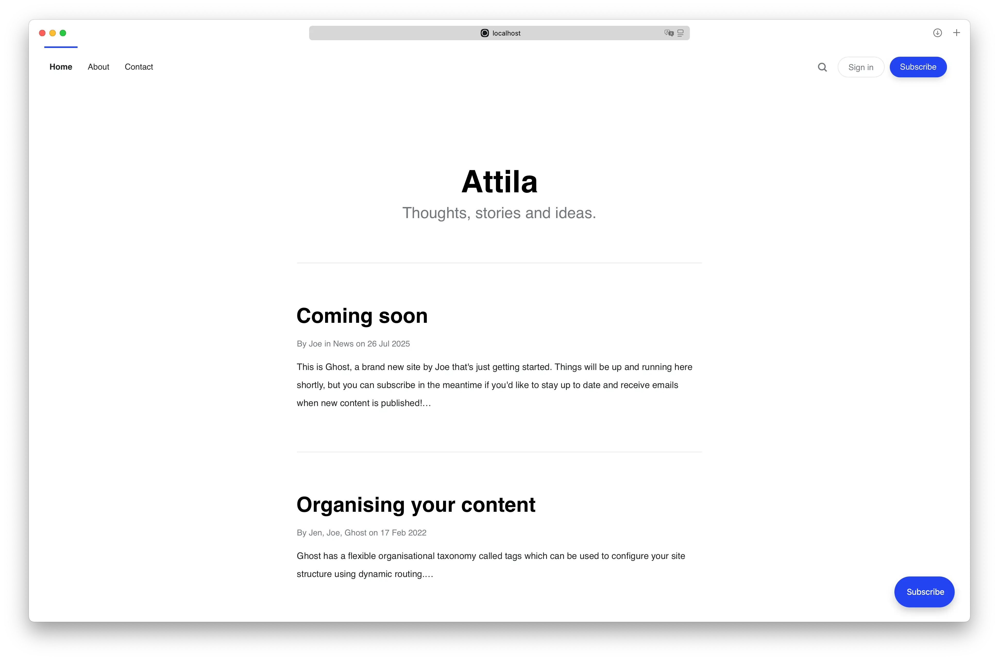

# attila-next

`attila-next` is an independent fork of [Attila](https://github.com/zutrinken/attila), a clean, content-focused responsive theme for [Ghost](https://github.com/TryGhost/Ghost), created to further improve and extend the original theme.



## Features

* Theme options
* Responsive layout
* Light and Dark Mode
* Search support
* Post reading progress
* Code highlight including line numbers
* Comments and Disqus (Theme option)
* Ghost accent color and custom fonts

## Documentation

* [Localization](docs/LOCALIZATION.md)
* [Development](docs/DEVELOPMENT.md)

# Origin of this fork

| | |
|---|---|
| Upstream project | attila, <https://github.com/zutrinken/attila> |
| Upstream author | Peter Amende |
| Upstream repository | <https://github.com/zutrinken/attila>, branch `master` |
| Upstream commit | `ea30f558530e08ca5f59813c90581d5ab6de270c` |
| Upstream commit date | 2025-07-31 09:53:23 UTC |
| Upstream commit title | fix header icon position in mobile |
| Forked on | 2026-11-16 06:47 UTC |

Commit `3cbf25b` of this repository ("Initial import of upstream attila") holds the files of that upstream commit unchanged, except for this README.md. The
upstream history was not imported, and later upstream changes are not brought into this fork.
Every change made in this fork since then is shown by

```
git diff 3cbf25b HEAD
```

## ⚖️ Copyright & License

Copyright (c) 2026 Nikolaos Baras ([@nikolaos572](https://github.com/nikolaos572))  
Copyright (c) 2015-2025 Peter Amende  
Released under the [MIT License](LICENSE).
